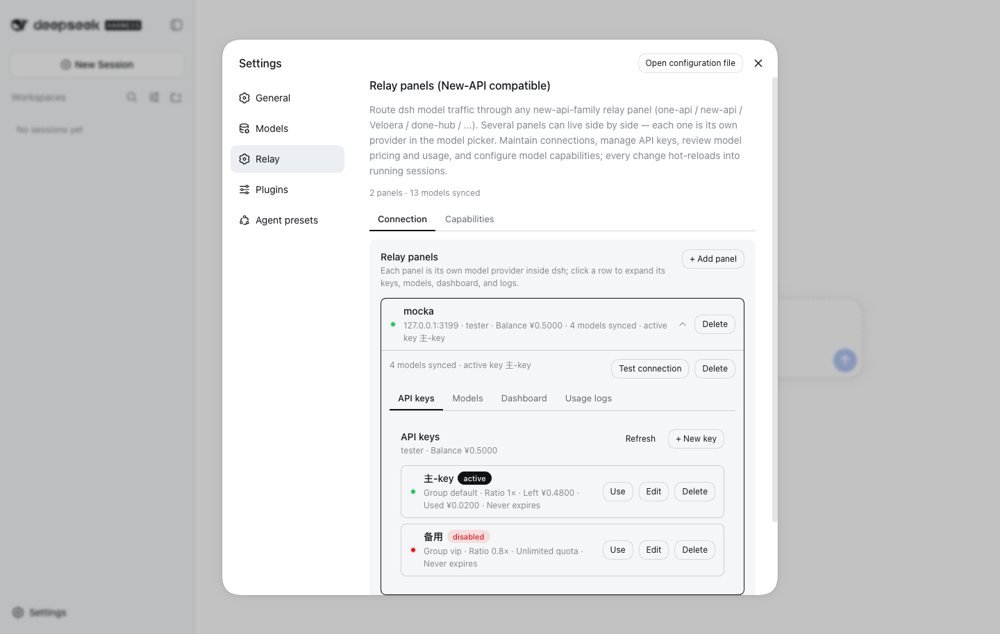
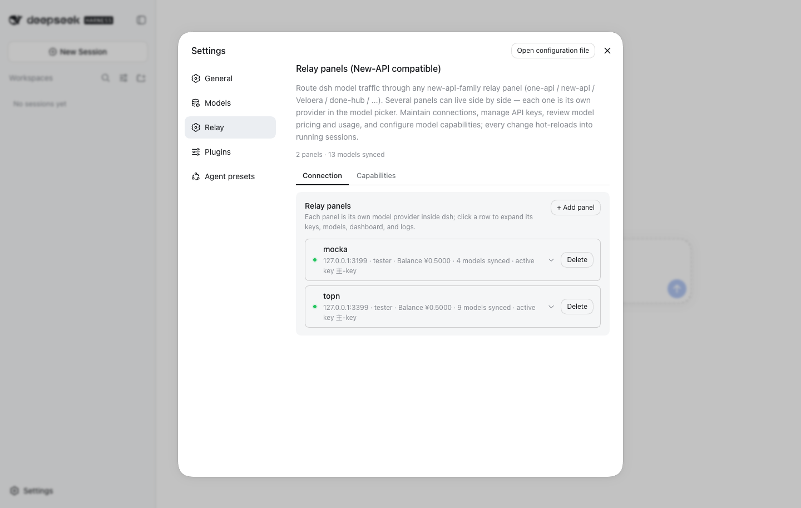
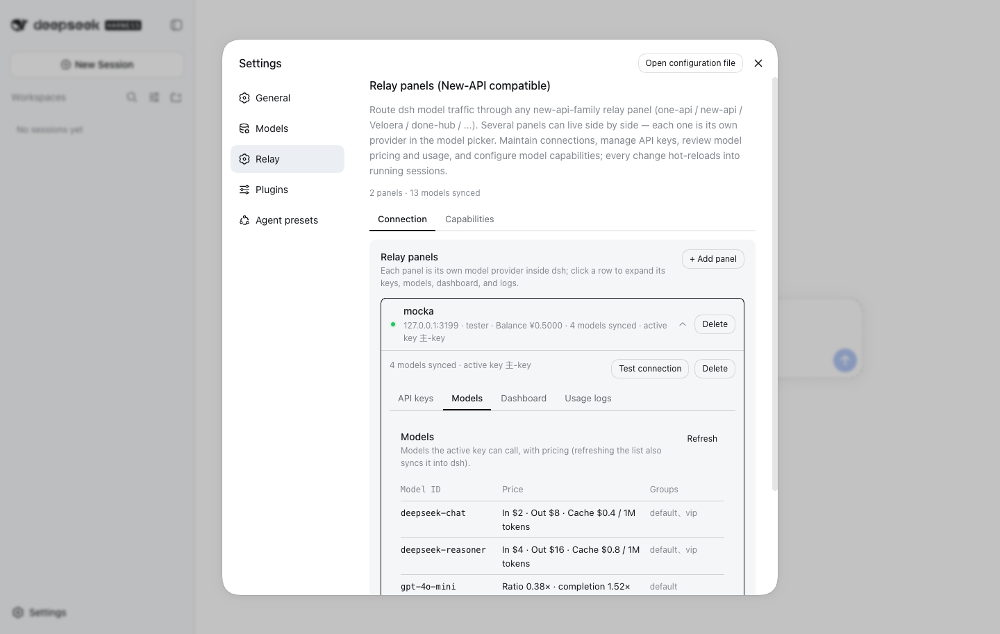
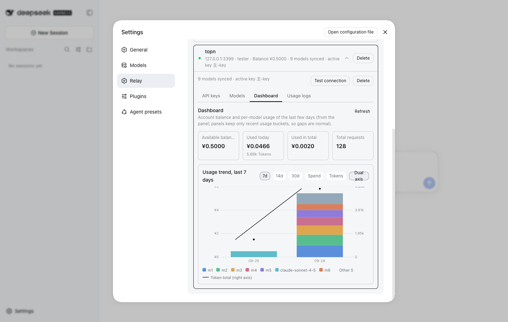
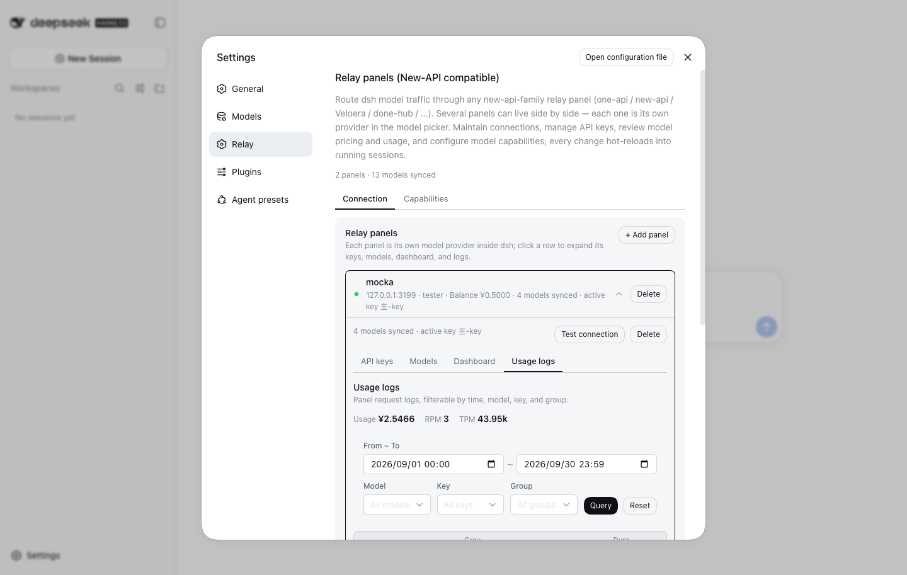
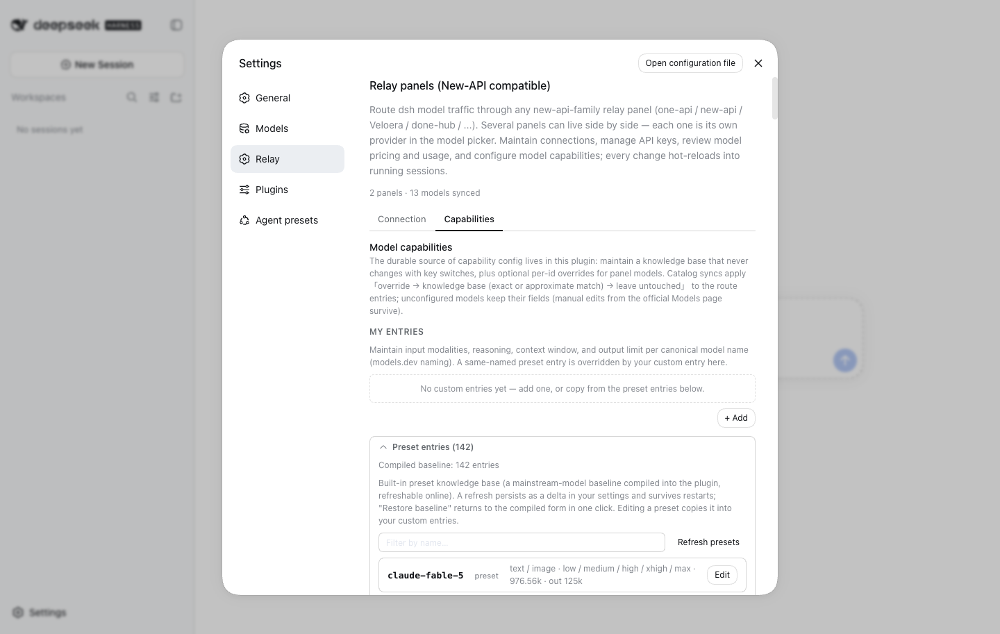

[English | 中文](README.zh.md)

# dsh-plugin-relay

A [DeepSeek Harness](https://github.com/deepseek-ai/deepseek-harness) (`dsh`) plugin that connects dsh to any **new-api-family relay panel** (one-api / new-api / Veloera / done-hub / ...). Everything lives in the dsh web settings page — no CLI, no config files to hand-edit, and no panel-specific defaults baked in. Since v0.6.0 you can connect **several panels at once** — each one is its own model provider inside dsh, selectable side by side in the model picker.



## Features

- **Panels** — the *Connection* tab is an **accordion**: every connected panel is a collapsible row (account, balance, synced models, active key at a glance — the account line fills in lazily, so one unreachable panel never blocks the list), and expanding it folds the panel's four sub-tabs (API keys / models / dashboard / usage logs) inline; at most one panel is expanded at a time. New panels are added with *Add panel*: name (immutable after creation — it names the dsh model provider too), base URL, access token (write-only), and user ID — there is **no edit form**; changing a connection means delete + re-create. Each panel gets a **Test connection** button that classifies failures readably: unreachable network, invalid token, or user-ID mismatch. The delete dialog warns about capability overrides being removed and about dsh's default model pointing at the panel.
- **API keys** (per panel) — create, edit (name / group / quota / expiry / enable-disable), delete, and switch with one click on *Use*. Editing happens **in place** like the official Models page: the row expands into an editor card (one card at a time), *Apply* writes immediately and keeps the card open on failure, and deletions confirm in a dialog. Key material never crosses to the browser — creation responses are stripped server-side, and *create and set active* runs the regular switch flow so the secret only enters the credential store.
- **Models** (per panel) — the models the active key can call with pricing, covering all three billing dialects of the panel family: per-token USD prices ($/1M tokens), fixed per-call prices, and classic ratio pricing (model ratio × group ratio). Refreshing the list syncs it into dsh so running sessions pick it up immediately.
- **Dashboard** (per panel) — balance, today's spend, totals, and a hand-drawn SVG stacked per-model usage chart with a **spend / tokens / dual-axis** metric toggle (dual mode: spend bars on the left axis plus a daily token-total line on the right axis), 7 / 14 / 30-day range pills, Top-N folding (models past the top 7 merge into one grey「Other」series), and a click-to-hide legend; the four summary cards always sit in one row. Panels keep only recent usage buckets, so sparse data renders as a readable empty state.
- **Usage logs** (per panel) — panel request logs with a usage/RPM/TPM header, time / model / key / group filters (applied on query), and per-request usage including cache and reasoning tokens plus first-response time.
- **Capabilities** — combines a **preset knowledge base** (compiled in from [models.dev](https://models.dev) **mainstream models** — first-party author providers, models released within the last year, dialogue models only — refreshable online with one button inside the preset panel) with your own entries and per-panel per-id overrides; a refresh **persists as a delta against the compiled baseline** (it survives restarts, and *Restore baseline* returns to the compiled form in one click). Every section edits **in place** like the official Models page — one row expands into an editor card, *Done* saves immediately, there is no global save button. Context windows and **output limits** accept `128K` / `1M` shorthand (1024-based) with a live conversion hint. Matching follows layered rules: override → knowledge base (exact → case-fold → stripped variant suffix → version-separator swap → unique variant completion → curated aliases), with approximate hits marked and the matched name shown under the model id. The platform-model section groups models by panel, each with a coverage indicator whose segments are **clickable to filter** that panel's list by source (preset / knowledge / override / unconfigured).
- **Multi-panel** — every panel is an independent pi-ai provider (`openai-completions` at `<panel>/v1` with its own credential reference), so dsh sessions see all panels' models at once, namespaced by provider. Deleting a panel removes its provider, its capability overrides, and its credential reference; the global knowledge base survives.
- **Hot reload** — credentials, model catalog, and capability config all go through the dsh settings/credentials services; a running session applies them on its next request, no restart. The plugin does **not** manage a default model — pick one in dsh itself.

## Screenshots

| Connection (panel list) | API keys | Models |
| --- | --- | --- |
|  |  |  |
| **Dashboard** | **Usage logs** | **Capabilities** |
|  |  |  |

## Install

Requires Node ≥ 20 and pnpm on PATH (dsh installs plugins through pnpm).

```sh
# from npm (once published)
dsh plugin --profile web add dsh-plugin-relay

# or from a local clone
npm install && npm run build
dsh plugin --profile web add /path/to/dsh-plugin-relay
```

Install into the `headless` profile the same way (`--profile headless`) if you use headless sessions. Then restart `dsh web` and open **Settings → Relay**.

## Usage

1. Open **Settings → Relay → Connection**, press *Add panel*, and fill in a name (letters/digits/`_`/`-`, ≤32 chars — it becomes the model provider's name), the panel origin (no `/v1` suffix), the access token from the panel's personal page (client token / access token), and the user ID shown on the same page. *Test connection* verifies the trio before you commit to keys.
2. Click the panel's row to **expand it inline**. On **API keys**, create a key if you don't have one (or press *Use* on an existing one). The plugin writes the key into the dsh credential store, builds the panel's model route, and syncs the key's model catalog. Repeat for as many panels as you like — they all stay live side by side.
3. On **Models**, review pricing per model; refreshing keeps dsh's route catalog in step with what the key can actually call.
4. On **Dashboard** and **Usage logs**, keep an eye on balance and consumption; both read the panel's reporting APIs read-only.
5. On **Capabilities** (main page), browse the preset entries (searchable, collapsed by default) and copy any of them into *My entries* when you need a tweak; a single *Refresh presets* button re-fetches models.dev for the newest values, **persists the difference as a settings delta**, and re-applies them to every panel's catalog — the refresh survives dsh restarts, and *Restore baseline* drops the delta again. Context windows and output limits take `131072`, `128K`, or `1M` alike. Edit a platform-model card only when a specific id needs different values — *Done* saves it right away for that panel.

## How it works

- The plugin registers a `relay` settings namespace holding a `panels` dict (each panel's connection fields; the access token is a secret field redacted on the wire), the global knowledge base, and per-panel override groups; it serves `/api/relay/{state,panels,panels-create,panels-delete,account,connection-test,keys,keys-create,keys-update,keys-delete,use,models,capabilities,model-info,knowledge-refresh,preset-restore,dashboard,logs,logs-stat,logs-meta}` inside dsh's authenticated web fence.
- On first key switch per panel it writes the panel's pi-ai route profile (`api: openai-completions`, `baseURL: <panel>/v1`, `apiKeyEnv: RELAY_API_KEY_<PANEL>`, merged model catalog) into dsh's settings — dsh hot-reloads routes, so no restart. The API key itself resolves per request from the panel's credential reference.
- Catalog sync merges by model id: manual edits of surviving ids are preserved; ids the key lost are removed, so dsh only offers models the key can call. Capability fields on the entries are **derived state**: each sync, each capability save, and each preset refresh replays the overrides → knowledge base (yours first, then the preset layer) over them. Only fields the plugin holds config for are written — anything you edit on the official Models page for unconfigured ids survives.
- Capability saves are **directed operations** (`catalogSet` / `catalogDelete` / `overrideSet` / `overrideDelete` with the owning panel) applied as per-entry settings path ops — deletions are real, not masked by deep merges — followed by revision-guarded replays over the affected route catalogs.
- The preset knowledge base is generated at build time by `npm run preset:fetch` (models.dev first-party whitelist, 365-day release window, non-dialogue models excluded, channel re-registrations deduped; optional OpenRouter usage backstop with `OPENROUTER_API_KEY`) and committed into the source; the *Refresh presets* button rebuilds it from a live models.dev fetch and **persists the difference against the compiled baseline** as the `capabilityPresetDelta` settings key — replaying the derivation into every configured route immediately. The delta survives restarts (it keeps applying over whatever baseline the installed plugin ships); *Restore baseline* (or deleting the settings key) is the only way back to the compiled form.

## Security notes

- Each panel's access token lives in a secret settings field (redacted on every wire surface, including nested inside the panels dict); API keys are written only to the server-side credential store (`.credentials.yaml`, 0600) and never returned to the browser — key creation responses are stripped server-side, and no "copy key" feature exists.
- All plugin routes sit inside dsh's browser trust fence (same origin + signed session); unauthenticated requests get 401.
- The models.dev lookup runs host-side (cached, single-flight); the browser never talks to third parties directly. The preset build script never touches the relay panel or any credential.

## Compatibility

- Requires dsh ≥ **0.1.5-rc.2** (`engines.dsh` enforces it) — that is the first host whose frozen browser module table ships `@deepseek-ai/dsh-client-ui-primitives`, which this plugin's UI consumes at runtime (the host supplies its own compiled copy; the package is not a runtime dependency — it is installed as a devDependency **pinned to the host-matching version** for types only, since the npm `latest` tag stays at an early rc even though version-matched builds publish in lockstep).
- Browser-tested against dsh **0.1.5-rc.2** and **0.1.5-rc.3** (the current npm line). The primitives subset this plugin uses (Button / Switch / Pill / Tag / StateDot / Menu / Modal) was diff-verified compatible through the **0.1.7-rc.1** git tag.
- The plugin deliberately sticks to that stable subset and re-runs a browser walkthrough whenever the dsh dev dependency is upgraded (see docs/PUBLISHING.md).

## Known limitations

- Management-API calls need the paired user ID (typed once per panel; see the panel's personal page).
- Model capacity falls back to id-prefix heuristics when neither the panel nor the knowledge base reports a value; unknown ids fall back to 131072 context / 8192 output.
- Knowledge-base matching demands equality at every layer (case-fold, suffix strip, version-separator swap, variant completion) and gives up on ambiguity; channel-named panel-specific models (e.g. `grok-video`) match nothing by design.
- The preset baseline only carries mainstream models — first-party providers released within the last year. Panels selling older or niche models fall back to unconfigured; add your own entries or wait for *Refresh presets* (same rules).
- A preset refresh persists as a delta over the compiled baseline; when the plugin ships a new baseline the old delta still applies on top (it encodes "what the last refresh wanted"), which can rarely produce baseline/delta disagreement — *Restore baseline* is the one-click exit.
- A panel's name is immutable after creation (it keys the provider route, credential reference, and override group); renaming means delete + re-add.
- Panels keep only recent usage-log detail and dashboard buckets; older data is the panel's retention policy, not a plugin bug.
- models.dev is a third-party snapshot — unlisted models and toggle-style reasoning fall back to manual configuration.
- Token-count shorthand is 1024-based (`128K` = 131072); a few vendors advertise decimal sizes (e.g. 200K = 200000), so check the live conversion hint before saving.

## Development

```sh
npm install        # @deepseek-ai/dsh is a devDependency; runtime has zero dependencies (schemastery is a peer)
npm run typecheck  # tsc --noEmit
npm run build      # tsdown → lib/index.js (host ESM) + lib/client.js (wrapped browser bundle)
npm test           # vitest: unit tests + mock relay panel, never touches a real dsh home
npm start          # dev launcher: dsh web --port 3098 against this repo's .dsh-home
npm start -- --no-open   # same, without opening the system browser
npm run preset:fetch    # regenerate src/knowledge-preset.generated.ts (models.dev mainstream baseline; OpenRouter backstop optional)
```

See [CHANGELOG.md](CHANGELOG.md) for release history, [docs/](docs) for development notes (worklog, specs, publishing checklist), and [AGENTS.md](AGENTS.md) for dsh integration semantics.

## License

[MIT](LICENSE)
