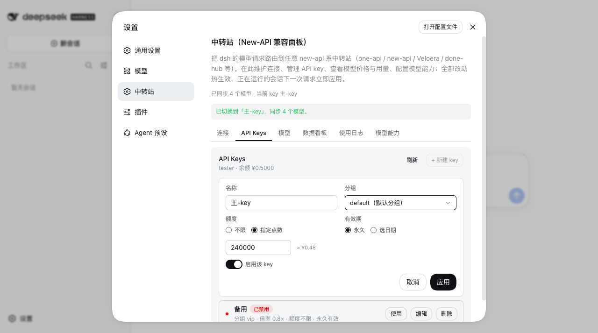
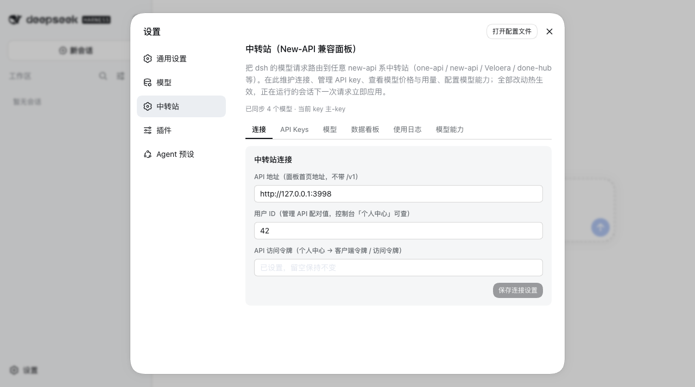
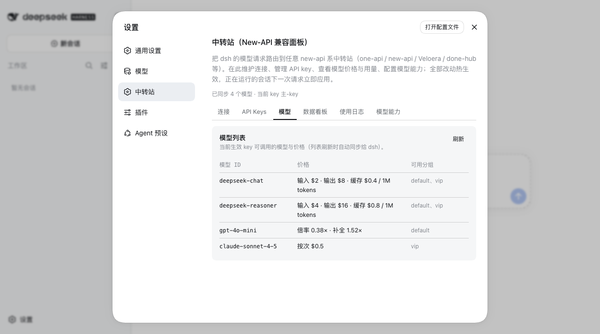
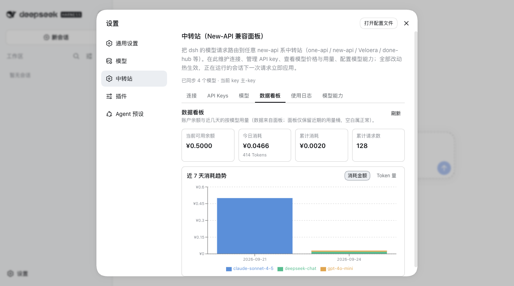
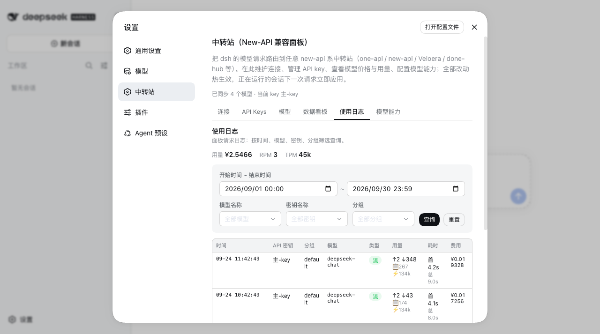
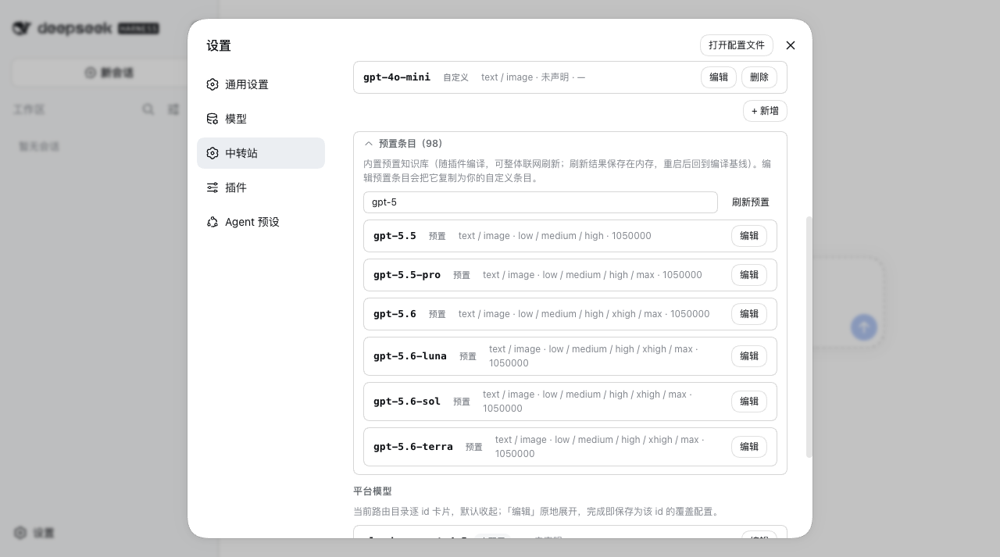

[English](README.md) | 中文

# dsh-plugin-relay

把 [DeepSeek Harness](https://github.com/deepseek-ai/deepseek-harness)（`dsh`，下称 dsh）接入任意 **new-api 系中转站面板**（one-api / new-api / Veloera / done-hub 等）的 dsh 插件。全部功能都在 dsh web 设置页——没有 CLI，不需要手工编辑配置文件，也不预置任何面板专属默认值。



## 功能

- **连接** — API 地址、访问令牌（只写不回显）、用户 ID 在「连接」选项卡维护，保存即热生效；连接字段由插件运行时镜像到 dsh 路由配置。
- **API Keys** — 「API Keys」选项卡管理账户全部 key：新建、编辑（名称 / 分组 / 额度 / 有效期 / 启停）、删除，以及一键「使用」切换。编辑采用**行内原地展开**（对齐官方「模型」页的行↔卡交互）：一次只展开一张编辑卡，「应用」即刻写入、失败卡不收起，删除经确认对话框执行。key 明文绝不经过浏览器——创建响应由服务端剥离，「创建并设为生效」走常规切换流程，明文只进服务端凭据文件。
- **模型** — 「模型」选项卡展示当前生效 key 可调用的模型与价格，覆盖面板家族的全部三种计价口径：按量美元价（$/1M tokens）、按次固定价、经典倍率价（模型倍率 × 分组倍率）。刷新列表时自动同步给 dsh，运行中的会话立即生效。
- **数据看板** — 「数据看板」选项卡展示余额、今日消耗、累计数据，以及近 7 天按模型的消耗堆叠图（金额 / Token 两种口径切换）；四张汇总卡固定一行。面板仅保留近期用量桶，稀疏数据有可读空态。
- **使用日志** — 「使用日志」选项卡列出面板请求日志：页头用量 / RPM / TPM 统计，时间 / 模型 / 密钥 / 分组筛选（点「查询」生效），用量列含缓存与推理 token 小字及首字耗时。
- **模型能力** — 「模型能力」选项卡由**预置知识库**（编译期从 [models.dev](https://models.dev) 主流厂商与面板公开模型列表生成，仅收录近 ~6 个月发布的模型，可一键联网刷新——按钮就在预置折叠面板内）、你的自定义条目与按 id 覆盖配置三层组成。三个分区都采用**原地展开编辑**（对齐官方「模型」页行↔卡交互）——一次展开一张卡，「完成」即保存，没有全局保存按钮；上下文窗口支持 `128K` / `1M` 简写（1024 进制）并实时显示换算。匹配规则与目录同步一致：覆盖 → 知识库（精确 id → 剥变体后缀）→ 不触碰，匹配到的知识库名显示在模型 id 下方。
- **热生效** — 凭据、模型目录、能力配置全部经 dsh settings/credentials 服务写入；运行中的会话在下一次请求时立即应用，无需重启。插件**不再管理默认模型**——模型请在 dsh 侧自行选择。

## 界面截图

| 连接 | API Keys | 模型 |
| --- | --- | --- |
|  |  |  |
| **数据看板** | **使用日志** | **模型能力** |
|  |  |  |

## 安装

要求 Node ≥ 20，pnpm 在 PATH 上（dsh 的插件安装走 pnpm）。

```sh
# 从 npm 安装（发布后）
dsh plugin --profile web add dsh-plugin-relay

# 或从本地 clone 安装
npm install && npm run build
dsh plugin --profile web add /path/to/dsh-plugin-relay
```

如需在 headless 会话使用，按同样方式装进 headless profile（`--profile headless`）。然后重启 `dsh web`，打开 **设置 → 中转站**。

## 使用

1. 打开 **设置 → 中转站 → 连接**，填写面板首页地址（不带 `/v1` 后缀）、面板「个人中心」的访问令牌，以及同一页面显示的用户 ID，保存。
2. 在「API Keys」页新建一个 key（或对既有 key 点「使用」）。插件会把 key 写入 dsh 凭据存储、建立模型路由（`<面板>/v1` 上的 `openai-completions`）并同步该 key 的模型目录。模型由 dsh 自己的模型选择器按会话决定，插件不干预。
3. 在「模型」页查看每个模型的价格；刷新列表会让 dsh 的路由目录始终与 key 的实际可调用集合一致。
4. 「数据看板」「使用日志」随时查看余额与消耗；两者只读面板的报表接口。
5. 「模型能力」页：预置条目默认折叠、可按名搜索，需要微调时一键复制进「我的条目」；「刷新预置」单按钮联网取最新值。上下文窗口 `131072`、`128K`、`1M` 写法等价。仅当个别面板模型 id 需要不同取值时才编辑对应卡片——「完成」即刻保存。

## 工作原理

- 插件注册 `relay` 设置 namespace（令牌为 secret 字段；你的能力条目与覆盖配置也存于此），并在 dsh 的浏览器信任围栏内提供 `/api/relay/{state,keys,keys-create,keys-update,keys-delete,use,models,capabilities,model-info,knowledge-refresh,dashboard,logs,logs-stat,logs-meta}` 路由。
- 首次切换 key 时，插件把 pi-ai 路由配置（`api: openai-completions`、`baseURL: <面板>/v1`、`apiKeyEnv: RELAY_API_KEY`、合并后的模型目录）写入 dsh 设置——dsh 对路由热加载，无需重启。API key 本身按请求从凭据引用（默认 `RELAY_API_KEY`）解析。
- 目录同步按模型 id 合并：存活模型的手工修正全部保留；key 已不可调用的模型会被移除，dsh 只会提供 key 真正能调用的模型。路由条目上的能力字段是**派生状态**：每次同步与每次能力保存都按「覆盖 → 知识库（自定义优先，其次预置层）」重放；只有插件持有配置的字段才会被写——你在官方「模型」页对未配置 id 的手工修改不会被冲掉。
- 能力保存是**定向操作**（`catalogSet` / `catalogDelete` / `overrideSet` / `overrideDelete`），逐条落到 settings 路径操作——删除真实生效，不会被深合并掩盖——随后对路由目录做一次修订守卫重放。
- 预置知识库由 `npm run preset:fetch` 在构建期生成（models.dev 主流厂商 ∪ 面板**公开** `/api/pricing` 模型列表，全程不涉凭据）并提交进源码；「刷新预置」按钮在宿主内存里用实时 models.dev 重建，重启后有意回落到编译基线。

## 安全说明

- 中转站访问令牌存于 secret 设置字段（接口层自动脱敏）；API key 只写入服务端凭据存储（`.credentials.yaml`，0600），从不回传浏览器——创建 key 的响应由服务端剥离明文，也不提供「复制 key」类功能。
- 插件全部路由位于 dsh 浏览器信任围栏内（同源 + 签名会话），未认证请求返回 401。
- models.dev 查询在宿主侧进行（带缓存与单飞合并），浏览器不直连第三方；预置生成脚本只读面板公开的 `/api/pricing`，不触碰任何凭据。

## 兼容性

- 要求 dsh ≥ **0.1.5-rc.2**（`engines.dsh` 强制）——这是首个在冻结浏览器模块表中携带 `@deepseek-ai/dsh-client-ui-primitives` 的宿主；本插件 UI 运行时消费该包（宿主供给自己编译的版本，插件不以它为运行时依赖——仅作为**精确锁版到宿主对应版本**的 devDependency 提供类型；npm 的 `latest` 标签虽停在早期 rc，但同版本构建一直在随 dsh 锁步发布）。
- 浏览器验收覆盖 dsh **0.1.5-rc.2** 与 **0.1.5-rc.3**（当前 npm 线）。本插件消费的 primitives 子集（Button / Switch / Pill / Tag / StateDot / Menu / Modal）经 diff 实证到 **0.1.7-rc.1** git tag 仍向后兼容。
- 插件有意只消费该稳定子集，并在每次升级 dsh 开发依赖后重跑一轮浏览器走查（见 docs/PUBLISHING.md）。

## 已知限制

- 管理 API 需要配对的用户 ID（手动填写一次；见面板「个人中心」）。
- 面板与知识库都未报告模型容量时，按 id 前缀启发式推断 context window / 最大输出，未识别的 id 回退 131072 / 8192。
- 知识库匹配最多剥两层尾部 `-变体` 后缀；渠道命名的面板特有模型（如 `grok-video`）按设计不匹配。
- 预置刷新只保存在宿主内存——这是设计而非缺陷，重启回落到编译基线；持久化新基线是 `npm run preset:fetch` 的职责。
- 面板对日志明细与看板桶只保留近期数据；更早的数据属于面板保留策略，不是插件缺陷。
- models.dev 是第三方快照——未收录的模型与 toggle 型推理以手动配置兜底。
- 上下文窗口简写按 1024 进制（`128K` = 131072）；个别厂商宣传十进制容量（如 200K = 200000），保存前请看实时换算提示。

## 开发

```sh
npm install        # @deepseek-ai/dsh 为 devDependency；运行时零 dependencies（schemastery 为 peer）
npm run typecheck  # tsc --noEmit
npm run build      # tsdown → lib/index.js（宿主 ESM）+ lib/client.js（浏览器包裹产物）
npm test           # vitest：单测 + mock 中转站面板，不触碰真实 dsh home
npm start          # 开发启动：dsh web --port 3098，使用本仓库 .dsh-home
npm start -- --no-open   # 同上，但不自动打开系统浏览器
npm run preset:fetch    # 重新生成 src/knowledge-preset.generated.ts（面板公开 pricing ∪ models.dev）
```

版本历史见 [CHANGELOG.md](CHANGELOG.md)；开发笔记（工作日志、任务书、发布清单）见 [docs/](docs)；dsh 集成语义见 [AGENTS.md](AGENTS.md)。

## 许可证

[MIT](LICENSE)
